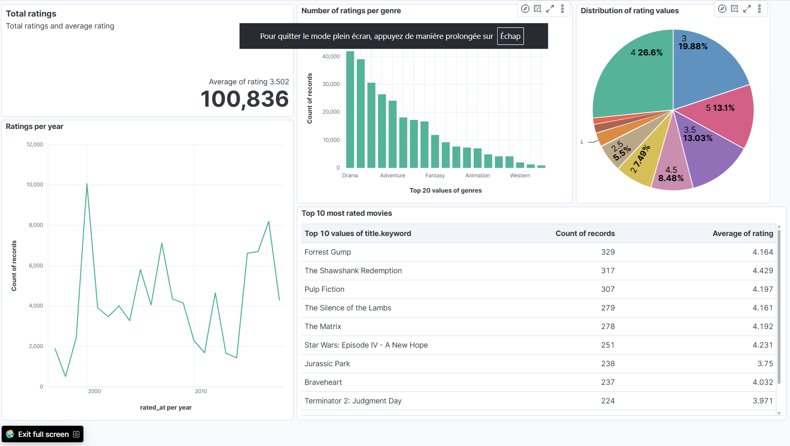

# MovieLens NoSQL Pipeline

A data pipeline that stores the **MovieLens** dataset in two NoSQL databases, **MongoDB** and **Cassandra**, transfers both into **Elasticsearch**, and analyzes them in a **Kibana** dashboard. Everything runs with **Docker Compose**.

> End-of-module project, NoSQL Databases course (IRM 2), École Polytechnique Internationale, Tunis.



## Architecture

```
movies.csv, tags.csv, links.csv ──► data_cleaning.py ──► MongoDB   (9,742 movies)  ──┐
                                                                                     ├──► transfer job ──► Elasticsearch ──► Kibana
ratings.csv ──────────────────────► prepare_ratings.py ──► Cassandra (100,836 ratings) ─┘   (Python,        movies, ratings     dashboard
                                                                                            Docker)
```

| Database | Data | Why this database |
|---|---|---|
| **MongoDB** | Movies | Rich documents read as a whole: genres, tags and links are embedded in each movie |
| **Cassandra** | Ratings | Many timestamped events with known queries: one table per query, fast reads by partition |
| **Elasticsearch** | Movies + ratings | Full-text search and aggregations on both sources |
| **Kibana** | — | Dashboard with 5 visualizations |

## Tech stack

Docker Compose · MongoDB 7.0 · Cassandra 5.0 · Elasticsearch 8.19 · Kibana 8.19 · Python 3.11 (pymongo, cassandra-driver, elasticsearch)

## Dataset

**MovieLens ml-latest-small** (GroupLens): 9,742 movies, 100,836 ratings from 610 users (1996–2018), 3,683 tags. See [data/README.md](data/README.md) to download it.

> F. Maxwell Harper and Joseph A. Konstan. 2015. The MovieLens Datasets: History and Context. ACM Transactions on Interactive Intelligent Systems (TiiS) 5, 4: 19:1–19:19. https://doi.org/10.1145/2827872

Data quality issues handled by the cleaning scripts: 13 movies without a year, 1,563 titles with a moved article ("Matrix, The"), 34 movies without a genre, 109 duplicate tags, 18 movies never rated.

## Data model

**MongoDB**, collection `movies`: one document per movie, with the rating summary kept in the movie (computed pattern). The ratings themselves stay in Cassandra, because they grow without limit.

```json
{ "_id": 1, "title": "Toy Story", "year": 1995,
  "genres": ["Adventure", "Animation", "Children", "Comedy", "Fantasy"],
  "tags": ["pixar", "fun"],
  "links": { "imdb": "tt0114709", "tmdb": 862 },
  "stats": { "rating_count": 215, "rating_avg": 3.92 } }
```
Indexes on `genres`, `year` and `tags`.

**Cassandra**, keyspace `movielens`: one table per query (query-first modeling).

| Query | Table | Primary key | Biggest partition |
|---|---|---|---|
| Ratings of a user, most recent first | `ratings_by_user` | `((user_id), rated_at, movie_id)` | 2,698 rows |
| Ratings of a movie, most recent first | `ratings_by_movie` | `((movie_id), rated_at, user_id)` | 329 rows |
| Ratings of a month, most recent first | `ratings_by_month` | `((year, month), rated_at, user_id, movie_id)` | 2,397 rows |

`movie_id` is part of the key of `ratings_by_user` because 15,790 ratings share the same user and second: without it, rows would overwrite each other. `(year, month)` is used instead of `year` alone to keep partitions small (2,397 rows instead of 10,061).

**Elasticsearch**: two indices. `movies` (title as `text` + `keyword`, genres as `keyword`, numbers as `integer`/`float`) and `ratings`. Elasticsearch has no joins, so the movie title, genres and year are copied into each rating.

## How to run

Requirements: Docker Desktop and Python 3.

```bash
# 1. Prepare the data (put the 4 MovieLens CSV files in data/ first)
python src/data_cleaning.py        # -> data/movies.json
python src/prepare_ratings.py      # -> 3 CSV files, one per Cassandra table

# 2. Download the Python packages of the transfer image (installed offline in Docker)
python -m pip download -r requirements.txt -d wheels --only-binary=:all: --python-version 3.11 --implementation cp --abi cp311 --platform manylinux2014_x86_64 --platform manylinux_2_28_x86_64

# 3. Start the databases, Elasticsearch and Kibana
docker compose up -d mongo cassandra elasticsearch kibana

# 4. Load MongoDB and Cassandra
docker exec movielens_mongo mongoimport --db movielens --collection movies --file /data/import/movies.json --jsonArray --drop
docker exec -i movielens_mongo mongosh movielens --quiet < mongodb/create_indexes.js
docker exec movielens_cassandra cqlsh -f /cassandra/schema.cql
docker exec movielens_cassandra cqlsh -f /cassandra/import.cql

# 5. Transfer MongoDB + Cassandra to Elasticsearch, with a count check
docker compose up -d --build
docker compose logs transfer
```

Expected transfer report:
```
MongoDB movies   -> ES movies : 9742 -> 9742  OK
Cassandra ratings -> ES ratings: 100836 -> 100836  OK
```

Then open Kibana at http://localhost:5601 and import the dashboard: Stack Management > Saved objects > Import > `kibana/dashboard.ndjson`.

## Queries

24 queries (11 simple, 13 advanced) on the three databases:

| File | Simple | Advanced |
|---|---|---|
| [mongodb/queries.js](mongodb/queries.js) | find, projection, filters on arrays, count | `$unwind`, `$group`, `$match`/`$sort`/`$limit`, statistics, `explain()` with index |
| [cassandra/queries.cql](cassandra/queries.cql) | SELECT in one partition | COUNT/AVG/MIN/MAX, range on the clustering column |
| [elasticsearch/queries.txt](elasticsearch/queries.txt) | match, term, range, count | bool, terms + avg, date_histogram, stats, terms ordered by a sub-aggregation |

The top movie with at least 50 ratings is **The Shawshank Redemption (4.43, 317 ratings)**, both in MongoDB (from the movie stats) and in Elasticsearch (from the 100,836 Cassandra ratings): the transfer is consistent.

## Dashboard

| Visualization | Question |
|---|---|
| Metric | How many ratings, and what is the average rating? |
| Bar chart | Which genres receive the most ratings? |
| Line chart | How does the rating activity evolve over time? |
| Pie chart | Which rating values do users give the most? |
| Table | Which movies are the most rated, and how good are they? |

## Project structure

```
├── docker-compose.yml        # MongoDB, Cassandra, Elasticsearch, Kibana, transfer job
├── Dockerfile                # image of the transfer job
├── requirements.txt
├── src/
│   ├── data_cleaning.py      # CSV -> movies.json (MongoDB)
│   ├── prepare_ratings.py    # ratings.csv -> one CSV per Cassandra table
│   └── transfer_to_elasticsearch.py
├── mongodb/                  # indexes, queries, Mongo Modeler diagram
├── cassandra/                # schema, COPY import, queries
├── elasticsearch/            # queries (Kibana Dev Tools)
├── kibana/                   # dashboard export
└── docs/screenshots/         # every step of the project
```

## What I learned

- Choosing a database from the shape of the data and the queries, not the other way around.
- Query-first modeling in Cassandra: partition key, clustering columns, and accepting duplicated data.
- Denormalizing for Elasticsearch, which has no joins.
- Building an ETL pipeline and **verifying** it with counts on both sides.
- Running a multi-service stack with Docker Compose: healthchecks, `depends_on`, volumes, and a containerized job.
- An engineering Git workflow: atomic commits and conventional commit messages.

## Possible improvements

- Load MongoDB and Cassandra automatically with init containers, so that the whole pipeline starts with one command on an empty machine.
- Replica set for MongoDB and several Cassandra nodes (replication factor 3).
- Enable Elasticsearch security (users, TLS) for a non-local deployment.
- A counter table in Cassandra (`stats_by_movie`) updated on each new rating.

## Author

**Azza Ghanmi**, Data Engineering student. [GitHub](https://github.com/AzzaGhanmi)